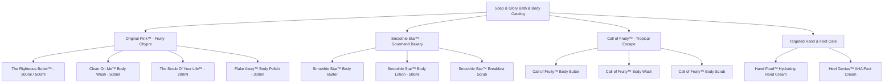

# Soap & Glory Bath & Body: Comprehensive SEO & Content Strategy Research Document

**Document Version:** 1.0  
**Target Market:** UK (Primary, Boots / Amazon.co.uk) & US (Secondary, Ulta / Amazon.com / Walgreens)  
**Brand:** Soap & Glory / No7 Beauty Company  
**Category Focus:** Body Wash, Shower Gels, Body Butters, Exfoliating Body Scrubs, Hand Creams & Foot Care

---

## 1. Executive Summary & Problem Analysis

### Previous Deficiencies
1. **Cookie-Cutter Repetition:**  
   The catalog H2 subtitle opened with the same generic phrasing: `"From our bestselling 72-hour Righteous Butter™... explore every award-winning formula..."`, matching the syntax of Skincare almost word-for-word.
2. **Missing High-Volume Search Variations:**  
   Real consumer search queries revealed significant demand for `soap and glory shower gel` (390/mo), `the scrub of your life` (320/mo), and `soap and glory exfoliator` (110/mo), which were underutilized in subheads and category filters.
3. **Loss of Sensory & Fragrance Storytelling:**  
   Unlike facial skincare (which is clinical and active-ingredient focused), Bath & Body is deeply sensory, tactile, and fragrance-driven. Bath & Body content must celebrate iconic fragrance notes (Original Pink bergamot/rose/patchouli, Smoothie Star warm vanilla/almond/honey, Call of Fruity mango/coconut/papaya) rather than echoing skincare tropes.

---

## 2. Verified Google Ads Keyword Research (UK / GB Market)

Data sourced directly via the Google Ads Search Volume & Keyword Planner API:

| Primary Keyword / Search Query | Monthly Search Volume (UK) | Competition Index | CPC | Search Intent & Category |
| :--- | :--- | :--- | :--- | :--- |
| **`soap and glory body butter`** | **2,400 / mo** | High (1.00) | £0.39 | High-Intent Transactional (Core hero) |
| **`soap and glory righteous butter`** | **2,400 / mo** | High (1.00) | £0.39 | Exact Brand SKU Search |
| **`righteous body butter`** | **2,400 / mo** | High (1.00) | £0.39 | Product Recall Query |
| **`soap and glory body wash`** | **1,300 / mo** | High (1.00) | £0.34 | Core Cleansing Category |
| **`soap and glory body scrub`** | **880 / mo** | High (1.00) | £0.49 | Core Exfoliation Category |
| **`soap and glory shower gel`** | **390 / mo** | High (1.00) | £0.43 | High-Volume Synonymous Query (Clean On Me) |
| **`soap and glory scrub of your life`** | **320 / mo** | High (1.00) | £0.69 | High-Intent Product SKU |
| **`scrub of your life`** | **320 / mo** | High (1.00) | £0.69 | Brand Recall Search |
| **`soap and glory exfoliator`** | **110 / mo** | High (1.00) | £0.52 | Broad Treatment Search |
| **`clean on me body wash`** | **140 / mo** | High (1.00) | £0.38 | Product SKU Search |
| **`the righteous butter body lotion`** | **70 / mo** | High (1.00) | — | Formulation Query (Lotion vs Butter) |
| **`soap and glory flake away`** | **50 / mo** | High (1.00) | — | Cult Salt & Shea Polish SKU |
| **`soap and glory sugar crush`** | **170 / mo** | High (1.00) | £0.25 | Citrus Fragrance Family Query |

---

## 3. Product Catalog Taxonomy & Sensory Fragrance Pillars

The Soap & Glory Bath & Body catalog consists of **12 SKUs** organized across **4 distinct Fragrance Families**:

---

## 4. The Authentic 3-Step Body Pampering Ritual

Unlike multi-step facial treatments, Bath & Body is a decadent 3-step British bathhouse ritual:

### Step 1: Lather & Soften (Conditioning Shower Cleanse)
- **Role:** Creamy, non-stripping shower gels enriched with natural citrus oils and built-in body lotions that produce luxurious mounds of velvet bubbles.
- **Hero SKU:** `Clean On Me™ Clarifying Shower Gel & Body Wash`

### Step 2: Buff & Polish (Body Exfoliation)
- **Role:** Granular polishes (sea salt crystals, crushed apricot stones, or brown sugar crystals) that slough away winter scaly skin, rough elbows, and prevent ingrown hairs.
- **Hero SKUs:**
  - *Firm Physical Buff:* `The Scrub Of Your Life™ Body Buffer`
  - *Ultra-Nourishing Salt & Shea:* `Flake Away™ Body Polish`

### Step 3: Seal 72-Hour Moisture (Intensive Butters & Silky Lotions)
- **Role:** Deeply penetrating whipped butters rich in cold-pressed shea, cocoa butter, and aloe vera that seal hydration into the skin barrier for up to 72 hours.
- **Hero SKUs:**
  - *Maximum Barrier Hydration:* `The Righteous Butter™ Body Butter`
  - *Warm Gourmand Daily Quench:* `Smoothie Star™ Body Lotion`

---

## 5. Non-Templated Editorial & Copywriting Strategy

### Prohibited Copywriting Habits
- ❌ **DO NOT use:** `"From our bestselling [Product A] to our [Product B], explore our complete range..."`
- ❌ **DO NOT copy:** Facial skincare phrasing into body care sections.

### Approved Bespoke Tone of Voice for Bath & Body:
- **Style:** "Gloriously Indulgent British Bathhouse Glamour" — sensory, tactile, aromatic, playful, celebrating opulent textures and intoxicating scents.
- **Hero Headline:**
  `SOAP & GLORY BODY BUTTER, SHOWER GEL &amp; BODY SCRUBS`
- **Hero Subtitle:**
  `"Immerse your shower routine in British luxury. Wrap skin in 72-hour moisture with our award-winning Righteous Butter™, lather in rich conditioning bubbles with Clean On Me™, and buff away dry roughness with crushed sea salt polishes."`
- **Catalog H2 Title & Subhead:**
  `SOAP & GLORY BODY WASH, BUTTERS & EXFOLIATORS`
  `"Step into velvety-smooth luxury. Whether you crave the iconic rose-and-bergamot of Original Pink™ or warm almond bakery notes, discover skin-transforming body butters, creamy washes, and smoothing scrubs."`

---

## 6. On-Page Technical SEO & Schema Blueprint

- **Page Title:** `Soap & Glory Bath & Body | Body Butter, Washes and Scrubs`
- **Meta Description:** `Shop official Soap & Glory Bath & Body heroes. Indulge in The Righteous Butter™ 72-hr body butter, Clean On Me™ body wash and shower gel, and The Scrub of Your Life™ body scrubs for velvety soft skin.`
- **Target Keywords:** `soap and glory body butter, soap and glory body wash, soap and glory righteous butter, soap and glory body scrub, soap and glory shower gel, clean on me body wash, scrub of your life, soap and glory exfoliator, flake away body scrub, hand food hand cream, heel genius`
- **Structured Data (JSON-LD):** Valid `CollectionPage` schema with nested catalog entities.
