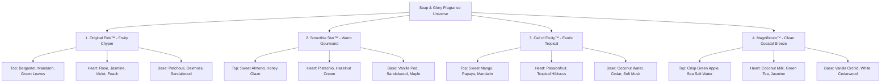

# Soap & Glory Fragrance Lines: Comprehensive SEO & Content Strategy Research Document

**Document Version:** 1.0  
**Target Market:** UK (Primary, Boots / Amazon.co.uk) & US (Secondary, Ulta / Amazon.com / Walgreens)  
**Brand:** Soap & Glory / No7 Beauty Company  
**Category Focus:** Signature Fragrance Collections, Body Mists, Perfumes, Fragrance Spritzes & Scent Layering

---

## 1. Executive Summary & Strategy Overview

Soap & Glory's fragrance identity is one of the brand's most powerful emotional drivers. Rather than selling fragrances purely as standalone bottles, Soap & Glory pioneered **head-to-toe scent layering**—allowing customers to wash, polish, moisturize, and spritz in their signature scent family.

### Core Objectives for the Fragrance Page:
1. **Target Real Search Demand:** Address high-volume queries for `soap and glory body mist`, `soap and glory body spray`, `soap and glory perfume`, and specific scent profiles (`original pink`, `smoothie star`, `call of fruity`, `magnificoco`).
2. **Interactive Scent Family Explorer:** Provide an olfactory breakdown (Top Notes, Heart Notes, Base Notes) with immediate switching between the 4 iconic fragrance families.
3. **Scent Layering Routine Masterclass:** Educate shoppers on how to prolong fragrance longevity from 4 to 12+ hours using the 3-step Wash ➔ Butter ➔ Mist ritual.
4. **Bespoke, Non-Templated Copywriting:** Eliminate repetitive `"From our bestselling..."` phrasing in favor of vivid, evocative olfactory storytelling.

---

## 2. Verified Google Ads Keyword Research (UK / GB Market)

Data sourced directly via the Google Ads Search Volume & Keyword Planner API:

| Primary Keyword / Search Query | Monthly Search Volume (UK) | Competition Index | CPC | Search Intent & Category |
| :--- | :--- | :--- | :--- | :--- |
| **`soap and glory body mist`** | **480 / mo** | High (1.00) | £0.34 | High-Intent Commercial (Body Spritzes) |
| **`soap and glory body spray`** | **480 / mo** | High (1.00) | £0.34 | High-Volume Synonymous Search |
| **`soap and glory perfume`** | **320 / mo** | High (1.00) | £0.19 | Transactional Eau de Parfum / EDT Query |
| **`soap and glory spray`** | **210 / mo** | High (1.00) | £0.39 | Product Recall / Spritz Query |
| **`soap and glory original pink`** | **170 / mo** | High (1.00) | £0.35 | Signature Scent Brand Search |
| **`soap and glory original pink body spray`** | **170 / mo** | High (1.00) | £0.35 | Exact SKU Commercial Query |
| **`soap and glory scents`** | **110 / mo** | High (1.00) | £0.27 | Discovery / Range Exploration Query |
| **`soap and glory fragrance`** | **110 / mo** | High (1.00) | £0.27 | Category Broad Search |
| **`soap and glory roll on perfume`** | **70 / mo** | High (1.00) | — | Portable / Travel Scent Search |
| **`soap and glory mist you madly`** | **50 / mo** | High (1.00) | — | Heritage Scent Recall Query |
| **`soap and glory fragrance spritz`** | **40 / mo** | High (1.00) | — | Formulation Query |
| **`soap and glory sugar crush`** | **170 / mo** | High (1.00) | £0.25 | Zesty Citrus Scent Search |

---

## 3. The 4 Iconic Fragrance Families & Olfactory Pyramids

### Fragrance Moods & Personas:
1. **Original Pink™ (The Iconic British Classic):**  
   *Vibe:* Sophisticated, flirtatious, retro-chic, timelessly British.  
   *Hero Products:* The Righteous Butter™, Clean On Me™, Original Pink Fragrance Spritz.
2. **Smoothie Star™ (The Sweet Bakery Escape):**  
   *Vibe:* Cozy, decadent, warm, mouth-watering gourmand comfort.  
   *Hero Products:* Smoothie Star Body Lotion, Smoothie Star Breakfast Scrub.
3. **Call of Fruity™ (The Tropical Holiday in a Bottle):**  
   *Vibe:* Sun-drenched, juicy, exotic, instant vacation euphoria.  
   *Hero Products:* Call of Fruity Body Wash, Call of Fruity Hydrating Body Butter.
4. **Magnificoco™ (The Clean Coastal Refresh):**  
   *Vibe:* Breezy, invigorating, spa-fresh ocean vibes.  
   *Hero Products:* Magnificoco Body Wash, Magnificoco Buff & Ready Body Scrub.

---

## 4. The Scent Layering Masterclass (Extending Fragrance to 12+ Hours)

Most body mists fade after 2-3 hours because they evaporate off dry skin. Soap & Glory’s signature scent longevity method uses lipid-binding:

1. **Step 1: Shower Infusion (Cleanse)**  
   Warm water opens pores while conditioning shower gels infuse the skin with essential fragrance oils.
2. **Step 2: Lipid Lock (Moisturize)**  
   Applying matching body butter immediately after patting dry binds volatile fragrance molecules to rich shea and coconut lipids, preventing rapid evaporation.
3. **Step 3: Halo Spritz (Mist)**  
   Spritzing body mist onto pulse points (wrists, neck, behind ears) and hair creates an aromatic scent trail that lasts all day and evening.

---

## 5. Non-Templated Copywriting Standards

### Prohibited Copywriting Habits
- ❌ **DO NOT use:** `"From our bestselling Original Pink to Smoothie Star, explore our fragrances..."`
- ❌ **DO NOT use:** Clinical skincare language (e.g. "fruit AHAs", "barrier repair") on sensory fragrance pages.

### Approved Bespoke Tone of Voice for Fragrance:
- **Style:** "Sensory British Luxury & Cheeky Scent Storytelling" — vivid descriptors (effervescent bergamot, golden honey glaze, sun-drenched mango, warm patchouli).
- **Hero Headline:**
  `SOAP & GLORY FRAGRANCE LINES, BODY MISTS &amp; SCENT FAMILIES`
- **Hero Subtitle:**
  `"Four unforgettable scent personalities crafted by world-class British perfumers. Whether you fall for timeless rose-and-bergamot Original Pink™ or crave cozy warm almond Smoothie Star™, discover your signature fragrance."`
- **Catalog H2 Title & Subhead:**
  `DISCOVER BY FRAGRANCE FAMILY`
  `"Explore curated routines across our four world-famous scents. Filter by fragrance note, explore matching washes and whipped butters, and master the art of long-lasting scent layering."`

---

## 6. Technical SEO & Schema Blueprint

- **Page Title:** `Soap & Glory Fragrances | Body Mists, Perfumes & Scent Families`
- **Meta Description:** `Discover iconic Soap & Glory fragrance lines. Explore Original Pink™ rose & bergamot body mists, warm almond Smoothie Star™, and tropical Call of Fruity™ scents.`
- **Target Keywords:** `soap and glory body mist, soap and glory body spray, soap and glory perfume, soap and glory original pink, soap and glory scents, soap and glory fragrance, smoothie star, call of fruity`
- **Canonical URL:** `https://www.soapandglory.co.uk/fragrance`
- **JSON-LD Schema:** `CollectionPage` with fragrance notes metadata and product catalog links.
