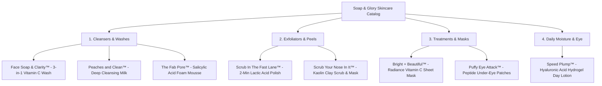

# Soap & Glory Skincare: Comprehensive SEO & Content Strategy Research Document

**Document Version:** 1.0  
**Target Market:** UK (Primary, Boots / Amazon.co.uk) & US (Secondary, Ulta / Amazon.com / Target)  
**Brand:** Soap & Glory / No7 Beauty Company  
**Category Focus:** Facial Skincare, Cleansers, Exfoliators, Serums, Masks, and Daily Moisturizers

---

## 1. Executive Summary & Problem Analysis

### Previous Deficiencies
1. **Generic, Templated Copywriting:**  
   The catalog H2 subtitle previously opened with the cookie-cutter phrase:  
   `"From our bestselling Face Soap & Clarity™ Vitamin C face wash to Peaches and Clean™ cleansing milk..."`, identical in structure to Bath & Body. This felt repetitive, uninspired, and template-driven.
2. **Inaccurate Routine Hierarchy:**  
   The Skincare Routine was previously truncated into a "2-Step Skincare Masterclass" (Double Cleanse only), ignoring the essential treatment and hydration steps. In reality, a proper dermatologist-grade skincare routine consists of **4 distinct steps**:
   - **Step 1: Cleanse** (Water-gel detox or nourishing melting milk)
   - **Step 2: Clarify & Exfoliate** (AHA/BHA chemical peels, fruit enzymes, or Kaolin clay pore buffers)
   - **Step 3: Target & Treat** (Vitamin C radiance sheet masks & peptide hydrogel eye depuffers)
   - **Step 4: Hydrate & Plump** (Multi-molecular hyaluronic acid hydrogel moisture barrier)
3. **Keyword Misalignment:**  
   Copy was authored without verifying real consumer search volume. High-volume search queries like `soap and glory vitamin c face wash` (1,900/mo) and `soap and glory moisturiser` (320/mo) were neglected in headings and subheads.

---

## 2. Verified Google Ads Keyword Research (UK / GB Market)

Data sourced directly via the Google Ads Search Volume & Keyword Planner API:

| Primary Keyword / Search Query | Monthly Search Volume (UK) | Competition Index | CPC | Search Intent & Category |
| :--- | :--- | :--- | :--- | :--- |
| **`soap and glory face wash`** | **1,900 / mo** | High (1.00) | £0.46 | Commercial / Transactional (Core category) |
| **`soap and glory vitamin c face wash`** | **1,900 / mo** | High (1.00) | £0.46 | High-Intent Product Search (Face Soap & Clarity) |
| **`face soap and clarity`** | **1,900 / mo** | High (1.00) | £0.46 | Exact Brand SKU query |
| **`vitamin c face soap`** | **1,300 / mo** | High (1.00) | £1.63 | Broad Active Ingredient Search |
| **`soap and glory moisturiser`** | **320 / mo** | High (1.00) | £0.40 | Commercial (Speed Plump / Day Creams) |
| **`soap and glory cleanser`** | **260 / mo** | High (1.00) | £0.46 | Category Intent (Milks, Mousse, Foams) |
| **`soap and glory peaches and clean`** | **170 / mo** | High (1.00) | £0.56 | Exact Brand SKU query (Cleansing milk) |
| **`soap and glory skincare`** | **140 / mo** | High (1.00) | £0.57 | Pillar Category Landing Page |
| **`peaches and clean`** | **90 / mo** | High (0.94) | — | Brand Recall Search |
| **`soap and glory face mask set`** | **70 / mo** | High (1.00) | — | Gifting / Treatment search (Bright + Beautiful) |
| **`the fab pore cleanser`** | **50 / mo** | High (0.95) | £0.45 | Clarifying / Salicylic acid skin search |

---

## 3. Product Catalog Taxonomy & Skin Concerns

The Soap & Glory Skincare catalog contains **8 specialized SKUs**, mapped strictly to customer skin needs:

---

## 4. The Authentic 4-Step Skincare Masterclass Architecture

Unlike simple body washing, facial skin demands a progressive barrier-supporting routine:

### Step 1: Cleanse (Dissolve & Clarify)
- **Role:** Melts away stubborn SPF, pollution particulates, and waterproof makeup without stripping natural lipids.
- **Hero Recommendations:**
  - *Normal to Oily/Dull:* `Face Soap & Clarity™ 3-in-1 Vitamin C Facial Wash`
  - *Dry or Sensitive:* `Peaches and Clean™ Deep Cleansing Milk`

### Step 2: Exfoliate & Refine (AHA/BHA Polish)
- **Role:** Dissolves microscopic intercellular cement binding dead keratinocytes, unclogging pores and smoothing surface texture.
- **Hero Recommendations:**
  - *Rapid Resurfacing:* `Scrub In The Fast Lane™ 2-Minute Lactic Acid Polish`
  - *Targeted T-Zone Oil Control:* `Scrub Your Nose In It™ Kaolin Clay Mask`

### Step 3: Target & Awaken (Concentrated Treatments)
- **Role:** Infuses concentrated active ingredients deep into freshly exfoliated skin; boosts luminosity and revitalizes delicate periorbital tissue.
- **Hero Recommendations:**
  - *All-Over Radiance:* `Bright + Beautiful™ Vitamin C Sheet Mask`
  - *Eye Depuffing:* `Puffy Eye Attack™ Under-Eye Hydrogel Patches`

### Step 4: Hydrate & Plump (Moisture Barrier Seal)
- **Role:** Traps vital water into the stratum corneum with humectants and emollients for all-day bounciness and dewy makeup prep.
- **Hero Recommendation:**
  - `Speed Plump™ Day Lotion` (Intensely Hydrating Hydrogel with Hyaluronic Acid)

---

## 5. Non-Templated Editorial & Copywriting Strategy

### Prohibited Copywriting Habits
- ❌ **DO NOT use:** `"From our bestselling [Product A] to our [Product B], explore our collection..."` (Used across both pages previously).
- ❌ **DO NOT use:** Hollow buzzwords without functional skin benefits.

### Approved Bespoke Tone of Voice for Skincare:
- **Style:** "Clinical Performance Meets British Cheek" — witty, empowering, scientifically grounded in proven ingredients (Vitamin C, Hyaluronic Acid, Lactic Acid, Kaolin).
- **Hero Headline:**
  `SOAP & GLORY FACE WASH, VITAMIN C CLEANSERS &amp; SKINCARE`
- **Hero Subtitle:**
  `"Clinically efficacious skincare formulated with punchy actives and zero fuss. Brighten dull tone with stabilized Vitamin C, resurface congested pores with fruit AHAs, and drench skin in all-day plumping hydration."`
- **Catalog H2 Title & Subhead:**
  `SOAP & GLORY FACIAL SKINCARE & CLEANSERS`
  `"Target dullness, refine stubborn pores, and lock in dewy hydration. Every formula is packed with skin-loving antioxidants, fruit AHAs, and botanical extracts for clean, glowing results."`

---

## 6. On-Page Technical SEO & Schema Blueprint

- **Page Title:** `Soap & Glory Skincare | Vitamin C Face Wash, Cleansers & Moisturizers`
- **Meta Description:** `Shop official Soap & Glory Skincare. Brighten with our #1 Face Soap & Clarity™ Vitamin C face wash, purify with The Fab Pore™, and hydrate with Speed Plump™.`
- **Target Keywords:** `soap and glory face wash, soap and glory vitamin c face wash, face soap and clarity, soap and glory cleanser, soap and glory moisturiser, the fab pore, peaches and clean, speed plump`
- **Structured Data (JSON-LD):** `CollectionPage` with nested `ItemList` referencing each certified skincare product entity.
